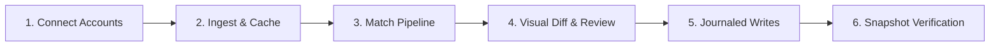

<div align="center">
  
  <h1>SoundShift</h1>
  <p><strong>Move and sync playlists locally between Spotify and YouTube Music without API keys, cloud servers, or track caps.</strong></p>

  <p>
    <a href="https://github.com/sizwinz/SoundShift/releases/latest"></a>
    <a href="https://github.com/sizwinz/SoundShift/actions/workflows/ci.yml"></a>
    <a href="https://github.com/sizwinz/SoundShift/releases"></a>
    <a href="LICENSE"></a>
    <a href="PRIVACY.md"></a>
  </p>

  <p>
    <a href="https://v2.tauri.app/"></a>
    <a href="https://www.rust-lang.org/"></a>
    <a href="https://react.dev/"></a>
    <a href="https://www.typescriptlang.org/"></a>
    <a href="https://www.sqlite.org/"></a>
  </p>

  <p>
    <a href="#download">Download</a> &bull;
    <a href="#features">Features</a> &bull;
    <a href="#two-way-sync">Two-Way Sync</a> &bull;
    <a href="#how-it-works">How It Works</a> &bull;
    <a href="#build-from-source">Build from Source</a> &bull;
    <a href="PRIVACY.md">Privacy</a>
  </p>

  <p>
    
    &nbsp;<strong>Spotify</strong>
    &nbsp;&nbsp;&harr;&nbsp;&nbsp;
    
    &nbsp;<strong>YouTube Music</strong>
  </p>
</div>

---

<div align="center">
  <video src="https://github.com/user-attachments/assets/9983d9d2-e760-4070-9f3c-5011bd2af2d5" width="880" autoplay="autoplay"></video>
</div>

<br />

## Why SoundShift?

Moving playlists across platforms usually forces a tradeoff between monthly cloud subscriptions, arbitrary track limits, or brittle scripts requiring DevTools headers. SoundShift runs directly on your machine with isolated WebView logins, shows every track match before mutating remote libraries, and keeps every token and backup inside local storage.

| Capability | Cloud SaaS Tools | CLI Scripts | SoundShift |
| :--- | :--- | :--- | :--- |
| **Account Login** | Third-party cloud OAuth | Manual cookie and header copying | Isolated in-app WebView login |
| **Pricing & Track Caps** | Paid tiers or 200-500 track caps | Free | Free, MIT open source, no track cap |
| **Pre-Write Safety** | Blind batch writes | Terminal logs | Visual Green / Amber / Red staging diff |
| **Two-Way Sync** | Subscription add-on | Manual re-runs | Built-in merge preview and hourly schedule |
| **Crash Recovery & Undo** | Limited or unavailable | Manual cleanup | SQLite mutation journals and 1-click rollback |
| **Data & Credentials** | Stored on vendor servers | Plaintext config files | OS Keychain / DPAPI, zero telemetry |

> [!NOTE]
> **Metadata-only transfers:** SoundShift reads and matches track metadata (titles, artists, albums, durations, and ISRC codes). It never downloads, rips, or redistributes audio files.

---

<a id="download"></a>
## Download (`v0.10.0`)

Pre-built desktop installers are published on [GitHub Releases](https://github.com/sizwinz/SoundShift/releases/latest) for Windows, macOS, and Linux:

| Platform | Architecture | Installer Packages |
| :--- | :--- | :--- |
| **Windows** | `x64` | [Setup EXE (`x64-setup.exe`)](https://github.com/sizwinz/SoundShift/releases/download/v0.10.0/SoundShift_0.10.0_x64-setup.exe) &bull; [MSI Installer (`x64_en-US.msi`)](https://github.com/sizwinz/SoundShift/releases/download/v0.10.0/SoundShift_0.10.0_x64_en-US.msi) |
| **macOS** | Apple Silicon (`aarch64`) | [Disk Image (`aarch64.dmg`)](https://github.com/sizwinz/SoundShift/releases/download/v0.10.0/SoundShift_0.10.0_aarch64.dmg) &bull; [App Tarball (`aarch64.app.tar.gz`)](https://github.com/sizwinz/SoundShift/releases/download/v0.10.0/SoundShift_aarch64.app.tar.gz) |
| **Linux** | `amd64` / `x86_64` | [AppImage](https://github.com/sizwinz/SoundShift/releases/download/v0.10.0/SoundShift_0.10.0_amd64.AppImage) &bull; [Debian Package (`.deb`)](https://github.com/sizwinz/SoundShift/releases/download/v0.10.0/SoundShift_0.10.0_amd64.deb) &bull; [RPM Package (`.rpm`)](https://github.com/sizwinz/SoundShift/releases/download/v0.10.0/SoundShift-0.10.0-1.x86_64.rpm) |

---

<a id="features"></a>
## Features

### Isolated In-App Authentication
Log into Spotify and YouTube Music directly inside incognito WebView popups. SoundShift verifies the live session before closing the login window and stores credentials in your native OS secret store: Windows Credential Manager (with per-user DPAPI fallback), macOS Keychain, or Linux Freedesktop Secret Service. Disconnecting an account clears stored tokens and WebView session cookies immediately.

### Visual Staging Diff & Disambiguation
Inspect every match in a 60 FPS virtualized table powered by `@tanstack/react-virtual` before writing a single track:
- **Exact Matches (Green)**: Matched deterministically via ISRC lookup, normalized metadata comparison, and duration bounds.
- **Ambiguous Matches (Amber)**: Candidate picker lets you listen to previews and confirm the right version.
- **Unmatched Tracks (Red)**: Step through unresolved rows, refine search queries, or paste a direct Spotify or YouTube track URL. Manual overrides persist in local SQLite for future transfers.

### 1-Click Snapshot Rollback & Crash Recovery
Before modifying a destination playlist, SoundShift writes an immutable pre-mutation snapshot and a durable operation journal into SQLite (WAL mode). Transfer History lets you inspect per-track outcomes, reconcile uncertain network writes against the live playlist, resume proven unsent or rejected batches without double-adding confirmed songs, or trigger guarded rollback.

### Portable Backups & Fast Keyboard Navigation
- Import tracklists from `JSON`, `CSV`, or `M3U8` files, or load public playlist URLs and IDs directly.
- Export staged match tables and completed transfer reports (`JSON`, `CSV`, `M3U8`) or generate sanitized diagnostic reports with tokens automatically redacted.
- Toggle close-to-tray background operation in Settings and navigate views rapidly using keyboard shortcuts.

| Shortcut | Action |
| :--- | :--- |
| <kbd>Ctrl</kbd>+<kbd>K</kbd> / <kbd>Cmd</kbd>+<kbd>K</kbd> | Open global command palette |
| <kbd>Ctrl</kbd>+<kbd>F</kbd> / <kbd>Cmd</kbd>+<kbd>F</kbd> | Focus active playlist or track filter |
| <kbd>Alt</kbd>+<kbd>Left</kbd> / <kbd>Alt</kbd>+<kbd>Right</kbd> | Step between unresolved tracks in Disambiguation Drawer |

---

<a id="two-way-sync"></a>
## Two-Way Playlist Sync

Link existing editable playlists between Spotify and YouTube Music from the **Sync** workspace:

1. **Initial Merge Review**: SoundShift inspects both playlists, flags edits or conflicts, and lets you adjust the unified song order before touching either service.
2. **Optional Hourly Schedule**: Once a baseline is verified, enable hourly background checks while SoundShift remains open (including minimized to the system tray). Closing the app halts scheduled runs cleanly.
3. **Occurrence-Aware Safety**: Intentional duplicate songs retain distinct occurrence records. Conflicting concurrent edits, incomplete reads, credential changes, or ambiguous writes pause the pair for manual review instead of guessing. Playlist names, descriptions, cover art, and visibility settings stay untouched.

> [!IMPORTANT]
> Spotify duplicate-occurrence removal via API lacks occurrence-level targeting, so removals on Spotify playlists containing repeated tracks require manual review before applying sync updates.

---

<a id="how-it-works"></a>
## How It Works



1. **Connect Accounts**: Acquire session credentials through isolated native WebViews and verify active endpoints.
2. **Ingest & Cache**: Fetch paginated playlist tracks (including Spotify Liked Songs and YouTube Music Liked Music) and cache locally in SQLite with a 15-minute TTL.
3. **Match Pipeline**: Run cached lookup first, then concurrent multi-pass matching (ISRC, normalized metadata, and duration-anchored scoring) with rate-limit backoff.
4. **Visual Diff & Review**: Review Green/Amber/Red matches, resolve ambiguous songs, and toggle destination deduplication.
5. **Journaled Writes**: Persist pre-mutation snapshots and execute sequential ordered writes (`1` writer on playlist mutations) with retry guidance.
6. **Snapshot Verification**: Re-read destination state to verify completed transfers or flag uncertain items for explicit reconciliation.

### Supported Services

| Service | Read & Liked Tracks | Create Playlist | Append & Deduplicate | Two-Way Sync | Auth Storage |
| :--- | :---: | :---: | :---: | :---: | :--- |
|  **Spotify** | Yes | Yes | Yes | Yes | Isolated WebView + OS Vault |
|  **YouTube Music** | Yes | Yes | Yes | Yes | Isolated WebView + OS Vault |

---

<a id="architecture"></a>
## Architecture

SoundShift pairs a React 19 TypeScript frontend with a Tauri v2 + Rust core:

- **Systems Core (`src-tauri/`)**: Direct HTTP/2 `reqwest` provider drivers (avoiding browser CORS limits without external proxies), multi-threaded Tokio matching workers, SQLite WAL schema (`cached_playlists`, `cached_tracks`, `track_match_cache`, immutable snapshots, sync baselines), OS keychain integration via `keyring-rs`, and strict IPC command boundaries (`withGlobalTauri: false`).
- **Presentation (`src/`)**: AMOLED true-black UI built with Tailwind CSS v4, `@tanstack/react-virtual` for smooth scrolling across large playlists, focus-trapped accessible portals, live transfer telemetry, and unified Sync review controls.

---

<a id="build-from-source"></a>
## Build from Source

### Prerequisites

- **Node.js**: `v22.12+` (`v24` recommended) and `npm`
- **Rust**: Current stable toolchain (`1.80+`, 2021 edition) via `rustup`
- **Platform Native Libraries**:
  - **Windows**: MSVC C++ Build Tools and Edge WebView2 Evergreen runtime
  - **macOS**: Xcode Command Line Tools
  - **Linux**: `libwebkit2gtk-4.1-dev`, `libgtk-3-dev`, `libayatana-appindicator3-dev`, `librsvg2-dev`, `libssl-dev`

### Development & Release Build

```bash
git clone https://github.com/sizwinz/SoundShift.git
cd SoundShift
npm install

# Run desktop app in development mode with Vite HMR
npm run tauri dev

# Build production installer bundles
npm run tauri build
```

<details>
<summary><strong>Test & Quality Verification Commands</strong></summary>

```bash
# Rust formatting check
cargo fmt --manifest-path src-tauri/Cargo.toml --check

# Rust lints (zero warnings policy)
cargo clippy --manifest-path src-tauri/Cargo.toml -- -D warnings

# Rust unit, safety, recovery, and sync tests
cargo test --manifest-path src-tauri/Cargo.toml

# Frontend unit and UI regression tests
npm test

# TypeScript typecheck and Vite production bundle
npm run build
```

</details>

---

## Documentation & Community

- [Privacy & Security Policy](PRIVACY.md): Details on zero telemetry, OS keychain storage, CSP, and credential purging.
- [Contributing Guidelines](CONTRIBUTING.md): Setup notes, PR workflow, and code quality rules.
- [Code of Conduct](CODE_OF_CONDUCT.md): Community participation standards.

## License

SoundShift is open-source software licensed under the [MIT License](LICENSE).
